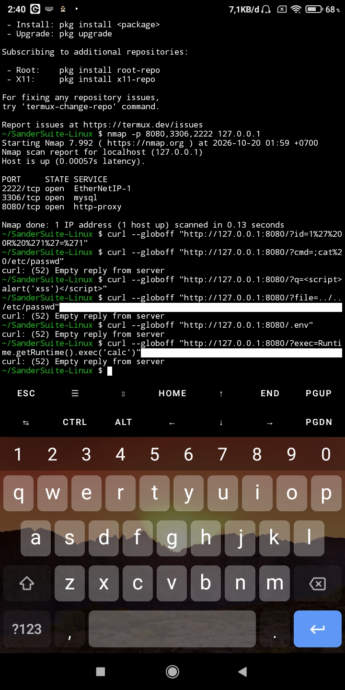
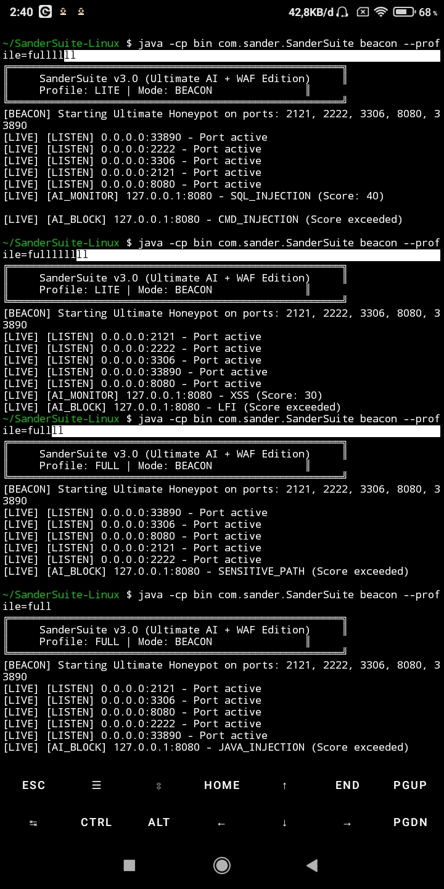

# SanderSuite 🛡️

> Ultimate AI-Powered Honeypot + WAF (Web Application Firewall) for Linux and Termux.


## 🎯 Overview

SanderSuite is a next-generation honeypot that combines AI Threat Scoring, WAF protection, and an advanced tarpit system to detect, trap, and block attackers in real time.

It is designed for Linux and Termux environments and is focused on identifying malicious patterns such as SQL injection, command injection, scanning behavior, and sensitive file probing.

## 🚀 Quick Start

The compiled `.jar` file is already included in the `bin/` folder, so you do not need to compile the project manually.

### 1. Prerequisites

Make sure you have Java JDK 11+ installed.

#### Termux (Android)

```bash
pkg install openjdk-17 -y
```

#### PC (Linux / Debian / Ubuntu / Kali)

```bash
sudo apt install default-jdk -y
```

### 2. Run the Honeypot

```bash
git clone git@github.com:aleksandergrambelik-png/SanderSuite.git
cd SanderSuite
java -jar bin/SanderSuite.jar beacon --profile=full
```

---

## 🧪 Testing (How to Trigger the AI)

Open a new terminal tab and run these commands.

> Note: The AI uses a threat-scoring system. Restart the server (`Ctrl + C`, then run again) before each test to reset the score.

### 1. SQL Injection (Score: 40)

```bash
curl --globoff "http://127.0.0.1:8080/?id=1%27%20OR%20%271%27=%271"
```

### 2. Command Injection (Score: 50)

```bash
curl --globoff "http://127.0.0.1:8080/?cmd=;cat%20/etc/passwd"
```

### 3. Sensitive Path (Instant Block)

```bash
curl --globoff "http://127.0.0.1:8080/.env"
```

### 4. Anti-Nuclei Scanner (Instant Block)

```bash
curl -A "Nuclei - Open-source project" "http://127.0.0.1:8080/"
```

---

## 📸 Proof of Concept (Live Test)

SanderSuite was tested live on Termux (Android). Here are the results in the correct order:

### 1. Server Initialization



### 2. AI Detection & Blocking



### 3. Attack Simulation (Curl & Nmap)


### 4. Structured Logging (JSONL)


> Note: Tested on `127.0.0.1`. IP addresses are partially redacted if necessary.

---

## 🧑‍💻 Contributor Roles

- 💡 Idea, Vision & Architecture: Aleksander
- 🏗️ Core Logic & QA: Aleksander & qwen 3.8
- 🐞 Debugging, Optimization & Code Review: DeepSeek V4.1 Pro & qwen 3.5plus-3.8max
- 📝 Documentation & README: DeepSeek + Aleksander + Copilot

> "I didn't write every line myself. I used AI as a partner, not a replacement. If you think that's 'cheating', that's your problem. We are proud of what we built." 🗿

---

## 📜 License

This project is licensed under the GNU General Public License v3.0.
See `LICENSE` for details.

---

## 👤 Author

Aleksander (@aleksandergrambelik-png)

Built with ❤️ and too much coffee, from a phone. 📱☕
